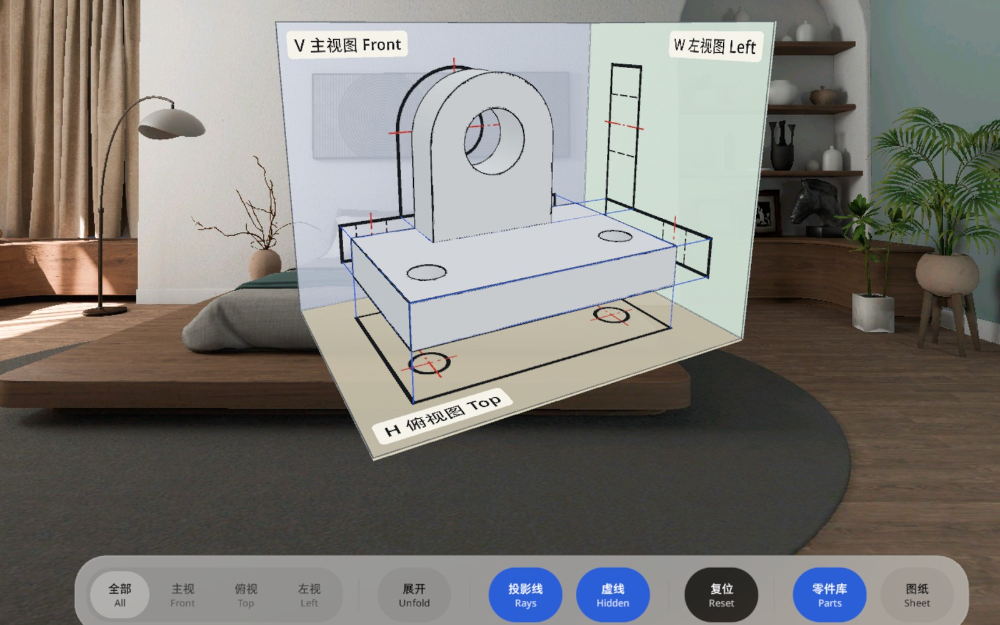
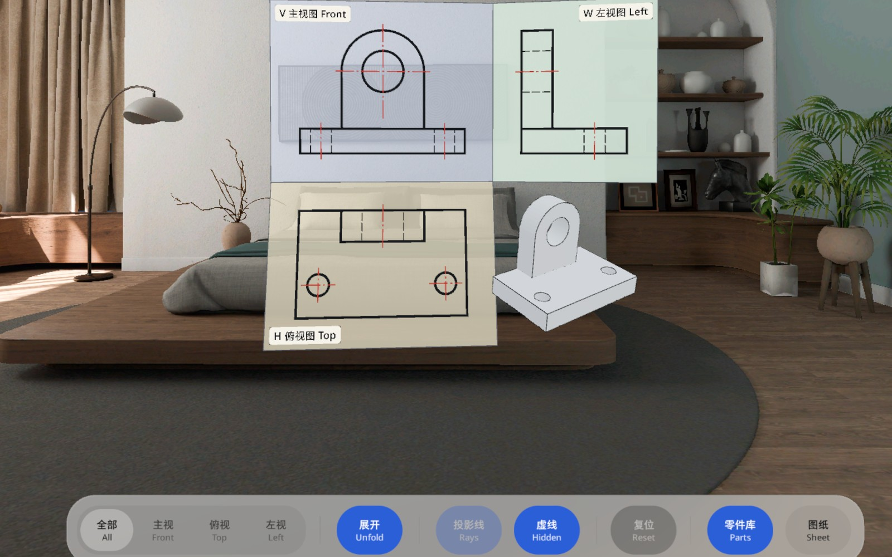

# 三视图 ThreeViews

工程制图课里的三视图，做成 PICO OS 6 的空间应用。给一个 3D 机械零件，把主视图、俯视图、左视图分别投影到三个真实存在的投影面上，再把三个面摊平成一张国标第一角画法图纸。

The three-view drawing from engineering graphics class as a PICO OS 6 (Project Swan) spatial app. A 3D part sits between three real projection planes; its front, top and left views are projected onto them, and the planes unfold into a GB first-angle sheet.





Demo video: [docs/media/ThreeViews-demo.mp4](docs/media/ThreeViews-demo.mp4) (44 s, PICO emulator).

## 三个表面 Three surfaces

Shared Space 里从左到右：

| 表面 Surface | 类型 Type | 内容 Content |
| --- | --- | --- |
| 零件库 Part library | Planar, 360 × 720 dp, opened at launch | 8 built-in parts: number, bilingual name, structure note, difficulty |
| 投影箱 Projection box | Volumetric, 0.8 × 0.72 × 0.9 m, the default container | the part, planes V / H / W, projection rays, bilingual name tags, a toolbar with ten controls |
| 图纸 Drawing sheet | Planar, 960 × 720 dp, on demand | axes, 45° line, three views, alignment guides, title block |

Controls: focus one view (segment control, tap a plane, or tap a view on the sheet), unfold / fold, rays, hidden lines, reset, open or close the two 2D windows; alignment guides on the sheet. Drag sideways to turn the box.

界面中英双语同时显示。All labels are shown in Chinese and English together.

## 技术 Tech

- PICO Spatial SDK 6.1.9, Kotlin, Jetpack Compose with SpatialUI (`com.pico.spatial.ui.*`) wrapped in `PicoTheme`. No Material.
- Parts are CSG solids in millimetres; visible, hidden and centre lines come from an exact hidden-line projection (`domain/geometry`).
- 3D runtime behaviour lives in ECS systems (`ui/box/scene`); Compose owns panels and controls only.
- 91 unit tests across ViewModels, use cases, repository and the projection algorithm.

## 构建 Build

```bash
./gradlew assembleDebug :app:testDebugUnitTest
adb install -r app/build/outputs/apk/debug/app-debug.apk
adb shell am start -n io.embodit.threeviews/.platform.LaunchActivity
```

Needs the PICO Spatial SDK (`PICO_HOME`) and JDK 21. Verified on the PICO 6.1 emulator; not yet run on a headset.

## 文档 Docs

- [docs/PRD.md](docs/PRD.md): product brief.
- [design/design-doc.md](design/design-doc.md) and [design/preview.html](design/preview.html): the accepted design package (two rounds).
- [AGENTS.md](AGENTS.md): guidance for coding agents, including SDK facts learned the hard way.
- Figma: https://www.figma.com/design/RclDoEx4Txn4LjQntiUlVM

## 字体 Font

Bundled font Noto Sans SC: SIL Open Font License (`third_party/noto-sans/OFL.txt`).
